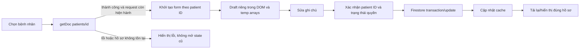

# Báo cáo audit mã nguồn và sửa lỗi ghi chú bệnh nhân

Ngày kiểm tra: 20/11/2026  
Phạm vi: repository cục bộ; không kết nối hoặc ghi Firebase Production; không deploy Vercel; không thay đổi Firestore Rules, indexes hoặc cấu trúc dữ liệu.

## A. Tổng quan dự án

### Kiến trúc thực tế

- Ứng dụng là frontend SPA tĩnh, phần lớn HTML/CSS/JavaScript nằm trong `index.html` (khoảng 9.500 dòng). Không có backend ứng dụng riêng trong repository.
- Firebase Web SDK 10.8.0 được import trực tiếp từ CDN. Ứng dụng dùng Google Authentication và Cloud Firestore.
- Collection chính là `patients/{patientId}`; lịch sử phụ còn được ghi tại `patients/{patientId}/historyLogs/{logId}`. Collection `users/{uid}` lưu vai trò và trạng thái phê duyệt.
- State biểu mẫu được giữ trong DOM và các biến `window.tempCurrentCycles`, `window.tempCurrentMarkers`, `window.tempIhc`, `window.tempResponseAssessments`, `window.tempToxicityAssessments`.
- Danh sách bệnh nhân được nạp bằng một listener `onSnapshot` toàn collection vào `cachedPatientsList`.
- Quyền truy cập được kiểm tra ở cả UI và `firestore.rules`: tài khoản đăng nhập, không bị khóa, và là Admin/VIP/đã duyệt mới được đọc hoặc ghi bệnh nhân.
- Vercel dùng cấu hình project cục bộ trong `.vercel` (đã bị `.gitignore`); repository không có bước build/deploy tùy chỉnh.
- Kiểm thử hiện có là các script Node `vm` dùng Firestore giả lập trong bộ nhớ, không gọi mạng.

### Luồng dữ liệu bệnh nhân



## B. Nguyên nhân lỗi ghi chú

### Nguyên nhân gốc đã xác minh

1. `resetFormToAddNewMode()` trước đây chỉ đổi trạng thái nút và `editCycleIndex`, không xóa `npCycleNote`, `npDrugNamesInput` hoặc `npDoseInput`.
2. `_openEditPatientModal()` nạp mảng chu kỳ của bệnh nhân mới nhưng không reset các ô draft chu kỳ. Vì DOM được dùng chung giữa mọi bệnh nhân, ghi chú đang nhập cho A tiếp tục hiển thị khi mở B.
3. Cả luồng mở form sửa và luồng xem chi tiết đều chờ `getDoc()` mà không có request token. Khi mở nhanh A → B, response A hoàn thành muộn có thể ghi đè state/giao diện B.
4. Luồng xem chi tiết còn gán `window.currentViewingPatient`; hàm lưu ghi chú HMMD dùng ID từ biến này. Vì vậy race ở màn hình chi tiết có nguy cơ gắn ghi chú HMMD với hồ sơ không phải hồ sơ người dùng vừa chọn.
5. Khi tải thất bại, mã cũ dùng dữ liệu cache và vẫn cho sửa. Điều này không phân biệt được dữ liệu mới nhất với dữ liệu cũ và không đáp ứng yêu cầu hiển thị lỗi tải rõ ràng.

### Bằng chứng

- Draft chu kỳ dùng chung được đọc trực tiếp từ `npCycleNote` khi tạo chu kỳ: `index.html:6738`.
- Hàm reset mới tại `index.html:4310` cho thấy đúng các trường trước đây không được reset.
- Luồng form sửa được cô lập bằng `_patientFormLoadSequence`: `index.html:6561`.
- Luồng chi tiết được cô lập bằng `_patientDetailLoadSequence`: `index.html:6358`.
- Ghi chú HMMD lấy patient ID từ `window.currentViewingPatient`: `index.html:4931`.
- Test tái tạo state tồn dư và đảo thứ tự response A/B: `tests/patient-note-isolation.cjs:37`.

### Nguy cơ đối với dữ liệu đã lưu

- Lỗi tồn dư DOM chắc chắn làm hiển thị sai draft ghi chú giữa hai hồ sơ.
- Chưa có bằng chứng repository cho thấy dữ liệu lịch sử đã bị ghi chéo trong Production.
- Trước bản sửa, nếu người dùng không nhận ra draft cũ và bấm thêm/lưu ở hồ sơ B, nội dung của A có thể được ghi vào mảng `cycles` của B. Race ở màn hình chi tiết cũng có khả năng làm ghi chú HMMD gắn sai hồ sơ.
- Cần kiểm tra audit/history thực tế bằng quy trình được phê duyệt riêng; audit này không đọc dữ liệu Production.

## C. Thay đổi đã thực hiện

### `index.html`

- Thêm `resetPatientCycleDraft()` để xóa ghi chú, thuốc, liều, lý do hoãn và index chỉnh sửa trước khi gắn dữ liệu bệnh nhân mới.
- Thêm sequence token riêng cho form sửa và màn hình chi tiết. Chỉ response của lần mở mới nhất được phép cập nhật state.
- Đóng form/chi tiết hoặc mở hồ sơ mới sẽ tăng token, vô hiệu hóa request cũ đang chạy.
- Bắt buộc `getDoc()` thành công và hồ sơ còn tồn tại trước khi mở state chỉnh sửa; lỗi mạng/quyền được thông báo và không dùng cache cũ như dữ liệu mới nhất.
- Không thay đổi schema Firestore, đường dẫn document, UI nghiệp vụ, dependency hoặc rules.

### `tests/patient-note-isolation.cjs`

- Thêm test mock không mạng cho reset ghi chú A → B.
- Thêm test response A hoàn thành sau B cho cả form sửa và màn hình chi tiết.
- Thêm test lỗi mạng và hồ sơ không tồn tại không được ghi đè state hiện tại.

Giải pháp an toàn vì mọi thay đổi nằm ở vòng đời state phía client, không migration, không ghi dữ liệu, và giữ nguyên payload lưu hiện có.

## D. Kiểm thử

Các lệnh đã chạy:

```text
node tests/patient-note-isolation.cjs
node tests/edit-cycle.cjs
node tests/delete-cycle.cjs
node tests/end-treatment.cjs
npm run typecheck
git diff --check
```

Kết quả tổng thể: tất cả lệnh trên PASS.

| Test | Trạng thái | Bằng chứng/phạm vi |
|---|---|---|
| 01 — A có ghi chú, B không có | PASS | Draft ghi chú được reset khi đổi hồ sơ. |
| 02 — A/B có ghi chú khác nhau | PASS | Test cô lập hai record và test edit giữ nguyên ghi chú record còn lại. |
| 03 — Sửa/lưu A, mở lại A | PASS | `tests/edit-cycle.cjs` xác nhận remote mock được cập nhật và panel được refresh. |
| 04 — Chuyển nhanh A → B → A | PASS | Sequence token được test với response trả về đảo thứ tự. |
| 05 — Mất mạng khi tải | PASS | State B được giữ nguyên; thông báo lỗi được tạo. |
| 06 — Lưu thất bại | PASS | Test transaction lỗi xác nhận không đóng modal, không báo thành công và phục hồi draft. |
| 07 — Nhấn lưu nhiều lần | NOT RUN | Có guard cho submit hồ sơ và trạng thái disabled ở modal, nhưng chưa có test tự động double-click riêng cho thao tác ghi chú. |
| 08 — Đổi patient ID khi đang lưu | NOT RUN | Transaction edit có target/fingerprint và các thao tác xóa có test context change, nhưng chưa có test end-to-end đổi hồ sơ trong lúc save ghi chú đang pending. |
| 09 — Đóng/mở nhiều lần, listener trùng | NOT RUN | Form ghi chú không tạo listener riêng; listener toàn collection chưa có test lifecycle. |
| 10 — Trường khác không bị ảnh hưởng | PASS | Ba suite regression hiện có và TypeScript typecheck đều PASS. |

Không chạy browser E2E, Firebase Emulator hoặc test Rules vì repository chưa cấu hình các hạ tầng này. Không tuyên bố PASS cho các phần đó.

## E. Các vấn đề khác phát hiện được

### P1 — Listener danh sách bệnh nhân không được quản lý vòng đời

- Bằng chứng: `loadAllPatientsRealtime()` gọi `onSnapshot()` nhưng không lưu hàm unsubscribe (`index.html:5587`); hàm có thể được gọi lại sau thay đổi auth (`index.html:5535`).
- Ảnh hưởng: listener trùng, cập nhật UI lặp, giữ dữ liệu trong bộ nhớ lâu hơn cần thiết; lỗi quyền sau logout chỉ được log.
- Phương án: lưu `unsubscribePatients`, gọi trước khi đăng ký lại và khi logout.
- Rủi ro sửa: thấp; cần test auth sign-in/sign-out/sign-in và các modal thống kê.

### P1 — Phạm vi đọc Firestore rộng

- Bằng chứng: mọi tài khoản Admin/VIP/đã duyệt được đọc toàn bộ `patients` (`firestore.rules:44`, `firestore.rules:49`) và client subscribe toàn collection.
- Ảnh hưởng: một tài khoản đã duyệt có thể tải toàn bộ hồ sơ bệnh nhân, không có scope theo bác sĩ/đơn vị.
- Phương án: xác nhận mô hình quyền nghiệp vụ; nếu cần least privilege, bổ sung ownership/tenant và Rules tương ứng trong một thay đổi được phê duyệt riêng.
- Rủi ro sửa: cao vì thay đổi Rules/schema/query và có thể làm gián đoạn Production; không sửa trong đợt này.

### P1 — Audit log HMMD không nguyên tử và được lưu hai nơi

- Bằng chứng: HMMD được `updateDoc()` trước, sau đó history được ghi vào mảng parent và thử ghi thêm subcollection (`index.html:4959`, `index.html:4873`, `index.html:4892`).
- Ảnh hưởng: mất mạng giữa các bước có thể khiến dữ liệu HMMD đã lưu nhưng audit log thiếu hoặc hai nguồn log không đồng nhất.
- Phương án: chọn một nguồn audit chuẩn và ghi HMMD + log trong transaction/batch.
- Rủi ro sửa: trung bình; cần kiểm tra dữ liệu log hiện hữu và tương thích UI trước khi chuyển đổi.

### P2 — File đơn khối gây khó kiểm chứng

- Bằng chứng: `index.html` khoảng 695 KB và gần 9.500 dòng, chứa UI, auth, state, Firestore access và nghiệp vụ.
- Ảnh hưởng: khó cô lập state, dễ tạo shared-state/race và test phải trích chuỗi JavaScript bằng vị trí marker.
- Phương án: tách dần patient loader/state/save thành module thuần, bắt đầu từ các hàm đã có test; không tái cấu trúc lớn một lần.
- Rủi ro sửa: trung bình nếu làm rộng; thấp nếu tách từng lát nhỏ có regression test.

### P2 — Thiếu kiểm thử Rules và browser lifecycle

- Bằng chứng: package chỉ có `typecheck`; test hiện tại là Node mock. Không có cấu hình Firebase Emulator, Rules test hoặc E2E browser.
- Ảnh hưởng: chưa tự động xác minh auth/rules, double-click thực tế, listener lifecycle và hành vi mạng chậm trong trình duyệt.
- Phương án: thêm bộ test nhỏ dùng Firebase Emulator cho Rules và một browser smoke test cho luồng A/B.
- Rủi ro sửa: thấp đối với Production nếu chỉ thêm hạ tầng test cục bộ; cần tránh dùng project Production.

## F. Đề xuất bước tiếp theo

1. Review và triển khai bản sửa qua môi trường staging/preview với dữ liệu giả; không trỏ preview vào dữ liệu Production nếu chưa có phê duyệt.
2. Chạy browser test thủ công cho TEST 01–10 trên Firebase Emulator, ưu tiên TEST 07–09 hiện còn NOT RUN.
3. Thêm unsubscribe cho listener bệnh nhân và test chu kỳ sign-in/sign-out/sign-in.
4. Thống nhất nguồn audit log HMMD và thiết kế transaction/batch trước khi sửa.
5. Tổ chức review quyền truy cập dữ liệu với chủ hệ thống; chỉ thay Rules/schema sau khi mô hình scope bệnh nhân được phê duyệt.
6. Tách dần patient state/load/save thành module nhỏ sau khi các test nghiệp vụ trọng yếu đã đủ.
